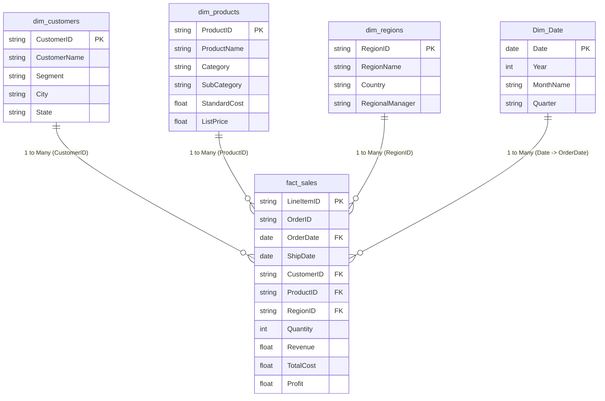

# 🔗 Data Modeling Guide: The Star Schema

The foundation of high-performance, accurate Power BI reports is **Data Modeling**. In Power BI, the industry standard is the **Star Schema**.

---

## 🌟 What is a Star Schema?

In a Star Schema, your data is separated into two kinds of tables:
1. **Fact Table (`fact_sales`)**: Contains measurable numerical event data (revenue, cost, quantities, transaction dates, IDs).
2. **Dimension Tables (`dim_customers`, `dim_products`, `dim_regions`, `Dim_Date`)**: Contain descriptive context (names, categories, locations, dates) used to filter, slice, and group the fact metrics.

The dimension tables surround the fact table like the points of a star.

---

## 📐 Relationship Architecture

---

## 🛠️ How to Set Up Relationships in Power BI Desktop

1. Switch to **Model View** (icon with 3 connected boxes on the far left sidebar).
2. Check if Power BI automatically detected the relationships.
3. If not, click and drag the key column from the dimension table to the matching column in `fact_sales`:
   - Drag `dim_customers[CustomerID]` ➡️ `fact_sales[CustomerID]`
   - Drag `dim_products[ProductID]` ➡️ `fact_sales[ProductID]`
   - Drag `dim_regions[RegionID]` ➡️ `fact_sales[RegionID]`
   - Drag `Dim_Date[Date]` ➡️ `fact_sales[OrderDate]`
4. **Cardinality**: Ensure each relationship is **One-to-Many (`1:*`)** where the dimension table is on the "1" side and `fact_sales` is on the "*" (many) side.
5. **Cross-filter direction**: Set to **Single** (filtering flows from the dimension table down into the fact table). Avoid "Both" unless you have a specific, advanced requirement.
